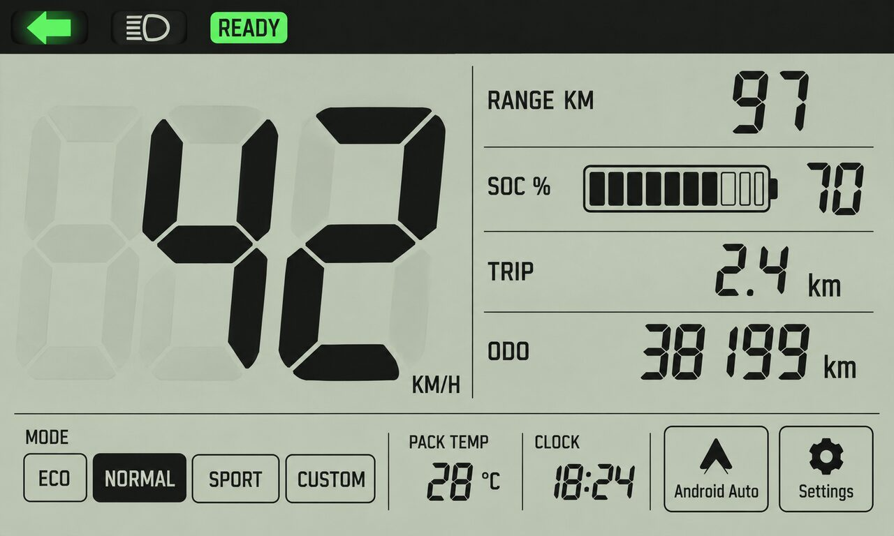
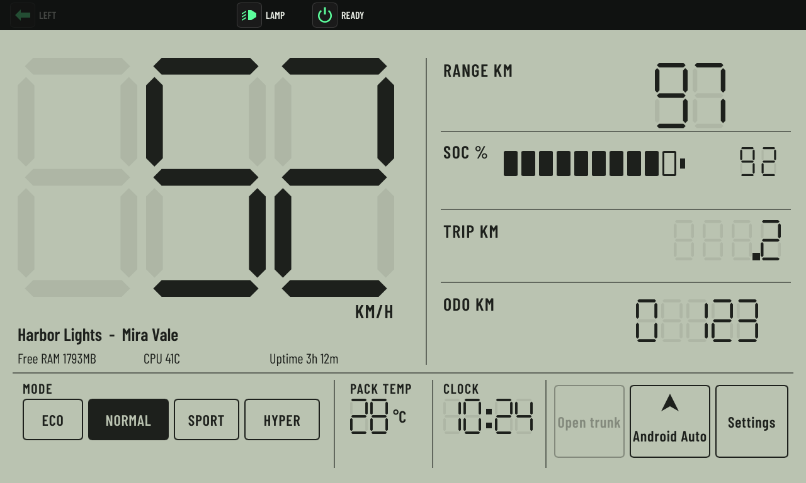
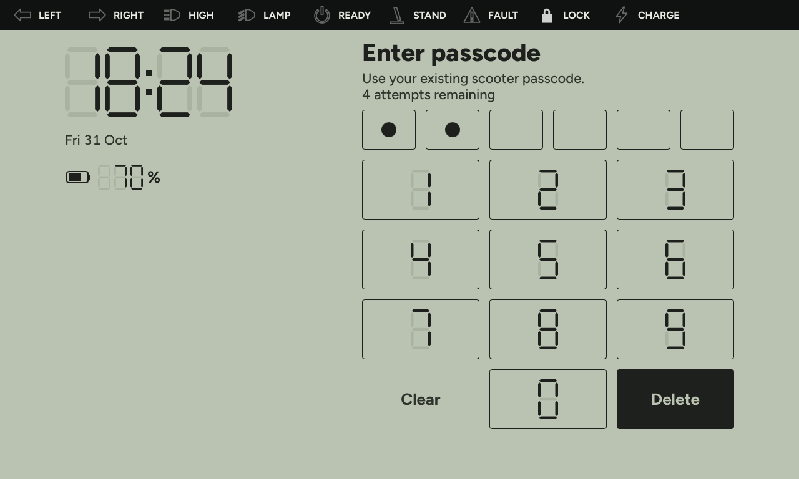
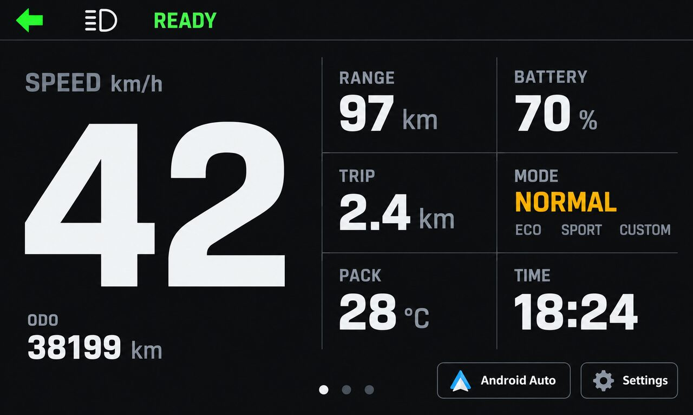
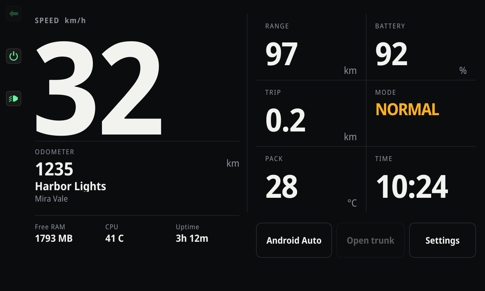
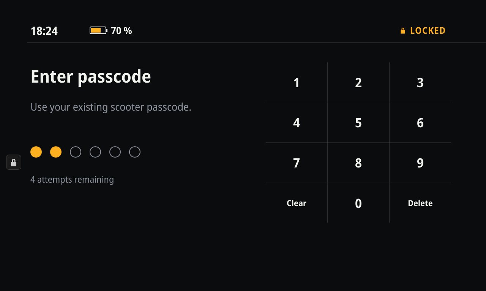
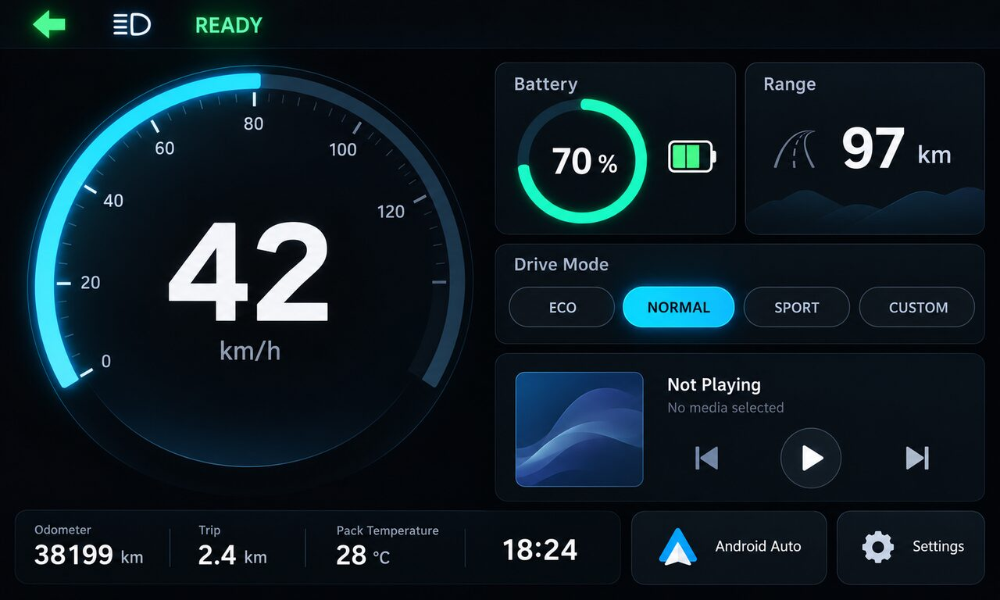
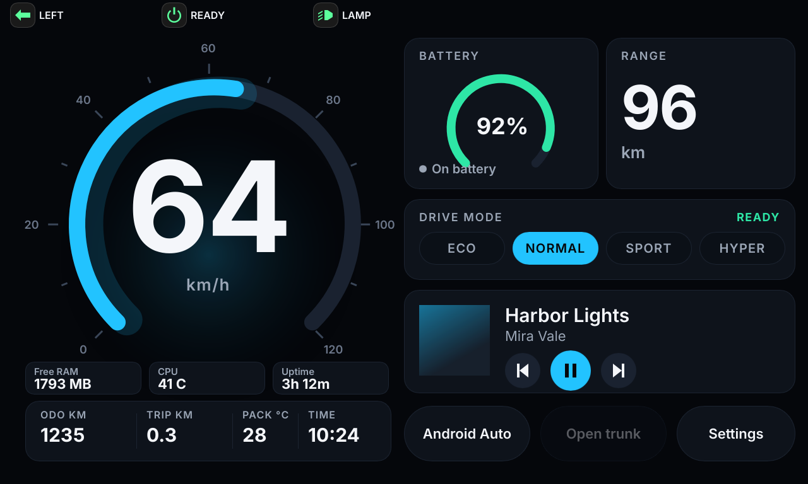
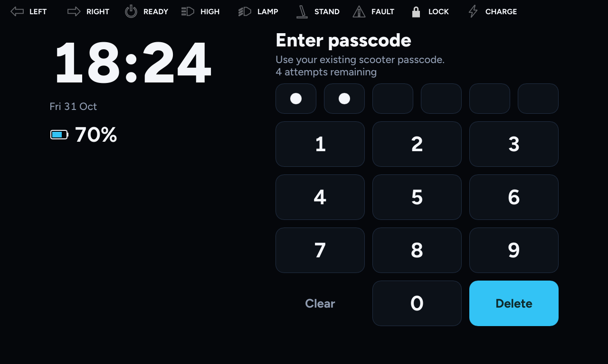

# Ola Dash SDK

An unofficial, open-source dashboard platform for the Ola S1 Pro Gen 1 electric scooter. It replaces the stock dashboard with a lightweight application built using Slint, reducing the application size from approximately 640 MB to 70 MB.

The interface is controlled by runtime-loaded `.slint` theme files, allowing themes to be changed without rebuilding the application. Plugins are distributed as separate Android APKs that publish data into named dashboard slots. The owner controls which plugins are enabled.

The host application retains control over all safety-critical interface elements, ensuring that themes and plugins cannot override essential vehicle information.

> [!WARNING]
> **Work in Progress: Experimental Version 0.1**
>
> This project is under active development. The theme contract, plugin API, file layouts, build procedures, and scooter behavior may change between versions. There are no stability guarantees before version 1.0.
>
> The host application is undergoing field testing on a rooted scooter. Themes can be developed and tested without physical scooter access. Expect unfinished features and potential issues.

**Disclaimer:** This is an independent community project and is not affiliated with, endorsed by, or supported by Ola Electric.

## Reference Themes

Three reference themes are included to demonstrate different dashboard layouts and customization possibilities.

| Theme | Description |
|---|---|
| Segment | Seven-segment speed display with ghost segments and top-positioned indicators |
| Data Fields | Cycling-computer-inspired layout with a large speed display and labeled information cells |
| Default | Arc gauge, battery ring, riding mode indicators, media card, and status indicators |

### Theme Screenshots

**Segment Theme**







**Data Fields Theme**







**Default Theme**







Each theme includes additional Park, charging, alert, and trunk-open interface states.

## Features

- **Runtime Themes:** Themes consist of a `main.slint` file and a `theme.json` configuration. The Slint interpreter loads themes dynamically without requiring Rust code changes or application rebuilds.
- **Versioned Theme Contract:** Themes access vehicle, battery, riding, media, and navigation information through a defined read-only interface.
- **Host-Owned Safety Overlay:** Warning indicators, alerts, passcode screens, and unlock interfaces are rendered above every theme and cannot be hidden.
- **Controlled Vehicle Actions:** Themes can only request the host to open the trunk. The host permits this operation only when the scooter is unlocked, in Park, and stationary.
- **Desktop Preview:** A simulator renders themes using mock data in a desktop window or as deterministic PNG screenshots.
- **Keep-Alive and Logging:** The host maintains the vehicle-parser service and records vehicle callbacks and raw CAN traffic for analysis.
- **Plugin System:** Owner-enabled Android APKs can publish dashboard widgets, media information, and navigation data.
- **Built-in Media Support:** The host includes its own media data source.
- **Optional Unlock Module:** Supports passcode entry through the stock profile service using the owner's existing passcode.

## Architecture

The application uses a layered architecture combining Android, Java, Rust, and Slint.

```text
Ola Vehicle Parser Service
          |
          | AIDL Callbacks
          v
VehicleBridge (Java)
          |
          | JNI
          v
Rust Host (Slint Runtime)
          |
          |-- Theme Loader
          |     |-- Vehicle
          |     |-- Display
          |     |-- Battery
          |     |-- Ride
          |     |-- Media
          |     |-- Navigation
          |     |-- Plugins
          |
          |-- Safety Overlay
          |
          |-- Plugin Host
                |-- IDashHost
                |-- IDashPlugin
                |-- Android Plugin APKs
```

### Architecture Components

- **Vehicle Parser:** Provides vehicle information through AIDL callbacks.
- **VehicleBridge:** Java component responsible for communication, service keep-alive, logging, and debugging.
- **Rust Host:** Runs the Slint interface and manages application functionality.
- **Theme Loader:** Dynamically loads dashboard themes and exposes vehicle data.
- **Safety Overlay:** Displays critical warnings and protected interface elements.
- **Plugin Host:** Manages owner-enabled plugins and their dashboard data.

## Quick Start

### Preview a Theme Without a Scooter

The desktop simulator requires:

- A recent stable Rust toolchain.
- Fontconfig development libraries.
  - Fedora: `fontconfig-devel`
  - Debian/Ubuntu: `libfontconfig1-dev`

**Run the simulator with mock data:**

```bash
cargo run --release --manifest-path sim/Cargo.toml -- themes/default
```

**Generate a headless PNG screenshot:**

```bash
mkdir -p sim/out

cargo run --release --manifest-path sim/Cargo.toml -- themes/default --screenshot sim/out/default-t75.png --at 75
```

**Validate all themes:**

```bash
tools/check-themes.sh
```

### Build the Android Host

The Android host can be built from a clean project checkout.

It communicates with the stock vehicle service through clean-room interface definitions implemented in the vehicle interface SDK.

The application combines Rust, Slint, Java, and Android components.

## Project Structure

```text
contract/           Theme contract and shared interfaces
host/               Android host, Rust runtime, Java bridge, safety overlay
sdk/plugin-api/     Plugin API v1 (AIDL)
plugins/            Example plugins
themes/             Reference themes: segment, fields, default, minimal
sim/                Desktop mock-data runner and preview tools
tools/              Theme validation and helper scripts
docs/               Documentation and screenshots
.github/            Continuous integration and project templates
```

## Documentation

| Document | Description |
|---|---|
| Architecture | Components, data flow, keep-alive, logging, and home-screen integration |
| Contract | Theme globals, fields, enums, units, and versioning rules |
| Themes | Theme development, configuration, size limits, and renderer capabilities |
| Plugins | Plugin API, enablement, media permissions, lifecycle, and limitations |
| Building | Development toolchain, compilation, installation, and uninstallation |
| Testing | Simulator screenshots, theme validation, test channels, and logs |
| Safety | Safety architecture and guidelines for owners and contributors |
| Roadmap | Planned functionality and project direction |
| Contributing | Development guidelines and contribution requirements |
| Changelog | Release history |
| Security | Vulnerability reporting information |

## Safety

The application follows a safety-oriented architecture:

- Safety overlays remain visible above all themes.
- Themes may customize the appearance and positioning of indicators but cannot hide warnings.
- Plugins cannot issue vehicle commands.
- Themes can make only one restricted vehicle request: opening the trunk.
- The host permits trunk operations only when the scooter is unlocked, in Park, and stationary.
- Passcode entry is handled exclusively by the host.
- The test channel is available only in debug builds and displays a TEST DATA banner.
- The application is experimental and should not be used for anything beyond glanceable information while riding.

Always review the safety documentation before installing or using the application.

## Disclaimer

Ola Dash SDK is an unofficial community project. It is not affiliated with, authorized by, sponsored by, or endorsed by Ola Electric.

The names Ola and S1 are used solely to describe compatibility. Installing the host replaces the stock home screen on a scooter you own and may affect its warranty.

Use this software at your own risk. Operating a vehicle with experimental software is the owner's responsibility.